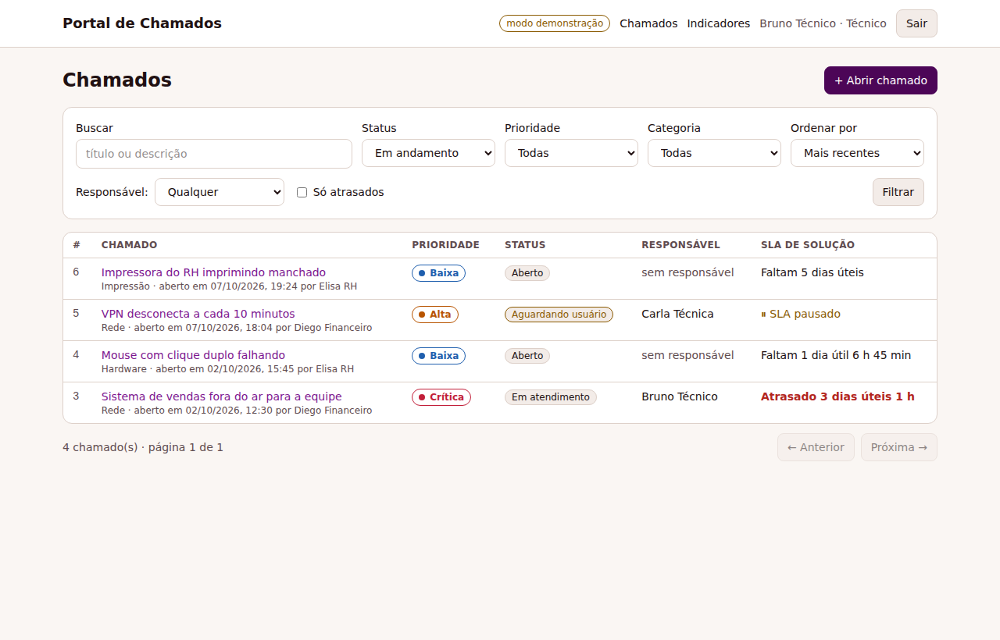
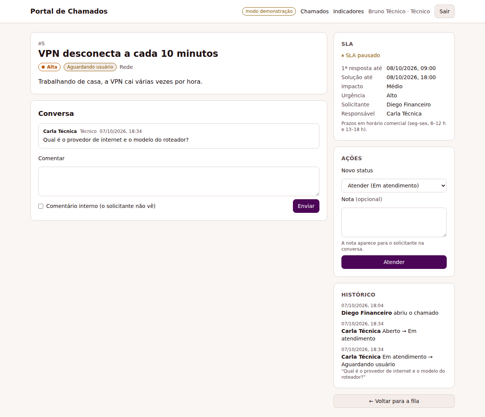

# Portal de Chamados

Front-end em **Next.js 16 + TypeScript** para a minha [API de Chamados em PHP](https://github.com/AdemarChamiNeto/api-chamados).

Pelo portal, o solicitante abre e acompanha os próprios chamados, e a equipe de atendimento trabalha a fila: assume os chamados, muda o status, comenta (inclusive com comentários internos) e acompanha o SLA e os indicadores.

**Demo:** [portal-chamados-swart.vercel.app](https://portal-chamados-swart.vercel.app/) (entre com `bruno@exemplo.com` / `senha-demo-123`)

Sem a API configurada, o portal roda em **modo demonstração**, com dados fictícios em memória, e pode ser publicado sozinho na Vercel.

<p>
  
  
</p>

**Stack:** Next.js 16 (App Router, Server Components, Server Actions, Cache Components) · React 19 · TypeScript · Tailwind CSS 4 · Zod · Vitest + React Testing Library · Playwright · GitHub Actions

## Funcionalidades

- **Login** com o token da API guardado num cookie **httpOnly**. O JavaScript do navegador não tem acesso ao token, e todas as chamadas à API saem do servidor do Next.
- **Verificação em duas etapas (opcional):** em "Minha conta", o usuário lê um QR code no app autenticador e recebe 10 códigos de recuperação. Depois disso o login pede o código, numa segunda tela.
- **Freio contra força bruta:** depois de 5 erros de login ou de código em 15 min, o IP do usuário espera.
- **Pronto para publicar:**
  - ícones, manifest, Open Graph (imagem 1200×630), JSON-LD (`WebApplication`), `robots.txt`, sitemap, `llms.txt`, página 404 e página de privacidade;
  - só login e privacidade são indexados (área logada com `noindex` e bloqueada no `robots.txt`);
  - Lighthouse 97 em performance e 100 em acessibilidade, boas práticas e SEO.
- **Estatísticas só com consentimento (LGPD):** GA4 e Clarity carregam apenas depois de "Aceitar". Os domínios deles só entram na CSP quando os IDs estão configurados.
- **Fila de chamados:**
  - filtros por status, prioridade, categoria, responsável ("meus", "sem responsável") e "só atrasados";
  - busca, ordenação e paginação;
  - todos os filtros ficam na URL, então dá para salvar e compartilhar a busca.
- **Abertura de chamado:** o usuário informa o impacto e a urgência, e a prioridade aparece na hora, junto com os prazos de SLA, pela matriz ITIL. Os erros de validação vêm do servidor, campo a campo.
- **Detalhe do chamado:**
  - SLA com o tempo restante em horas úteis, pausado enquanto aguarda o usuário;
  - conversa com comentários internos, visíveis só para a equipe;
  - histórico de alterações.
- **Ações conforme o papel:** o portal mostra só as transições que a API permite para quem está logado, e exige nota ao resolver, cancelar ou pedir informação. O técnico pode assumir ou largar o chamado.
- **Indicadores** para a equipe: fila por status, prioridade e categoria, quantidade de chamados atrasados e % de cumprimento do SLA.
- **Acessibilidade:** campos com label e erros ligados por `aria-describedby`, `aria-invalid`, foco visível, link "pular para o conteúdo", tabela com `caption` e tema claro e escuro.
- **Aguenta a API instável** (testado com o [Chaos Proxy](https://github.com/AdemarChamiNeto/chaos-proxy) na frente da API): repete consultas que falharam, respeita o `Retry-After`, para de bater numa API fora do ar (circuit breaker) e mostra um aviso claro no lugar da página, com "Tentar de novo".

## Arquitetura

```
src/
  proxy.ts                 checagem otimista: sem cookie de sessão → /login?voltar=...
  app/
    actions.ts             Server Actions: login (+ código do 2FA), logout, 2FA, abrir, mudar status, comentar, assumir
    login/  login/codigo/  conta/  chamados/  chamados/[id]/  chamados/novo/  indicadores/
  lib/
    api/contract.ts        interface ChamadosApi + ApiError (formato de erro da API)
    api/http.ts            cliente da API real: token, timeout, novas tentativas e normalização de erros
    api/resilience.ts      espera crescente, Retry-After e circuit breaker (relógio e sorteio injetáveis)
    api/falha.ts           traduz falha da API em aviso para o usuário
    api/demo.ts            mesma interface, em memória, com as regras da API portadas
    server/session.ts      cookie httpOnly + "data access layer" (getSession/requireSession) + cookie do 2FA pendente
    server/rateLimit.ts    freio por IP do usuário no login e no código do 2FA
    totp.ts                TOTP (RFC 6238) para o modo demonstração
    calendar.ts priority.ts filters.ts labels.ts redirect.ts
tests/
  unit/                    Vitest + Testing Library
  e2e/                     Playwright contra o build de produção (modo demonstração)
  e2e-api/                 Playwright contra a API PHP de verdade (MySQL em container)
```

### Decisões

- **BFF (back-end for front-end).** O navegador nunca fala com a API PHP. As páginas são Server Components que buscam os dados no servidor, e as mutações são Server Actions. Assim o JWT fica fora do alcance de XSS e não é preciso configurar CORS.
- **Um contrato, dois back-ends.** `ChamadosApi` tem duas implementações:
  - `HttpChamadosApi`, que fala com a API real;
  - `DemoChamadosApi`, uma cópia em memória das regras dela: matriz ITIL, horário comercial, pausa de SLA, transições por papel e comentários internos.

  As telas não sabem qual das duas está rodando. Os testes do modo demo usam os mesmos casos dos testes da API em PHP.
- **Tratamento de erros central.** Todo request passa por um único método, que faz o papel de interceptor. Ele põe o token, aplica timeout e converte respostas de erro (inclusive falha de rede ou HTML de proxy) em `ApiError`. Um 401 em qualquer ação limpa a sessão e manda para o login com "sua sessão expirou".
- **Resiliência medida, não suposta.** Com o [Chaos Proxy](https://github.com/AdemarChamiNeto/chaos-proxy) entre o portal e a API, `scripts/caos.ts` dispara 30 consultas em cada cenário com o cliente antigo e o atual (números de uma rodada; variam um pouco, porque as falhas são sorteadas):

  | Cenário | Antes | Depois |
  |---|---|---|
  | API instável (503, queda, lentidão) | 20/30 | **30/30** |
  | HTML de proxy no lugar de JSON (50%) | 14/30 | **26/30** |
  | API travada | 30 × 8 s esperando (80 s) | circuito abre: **25 s** e menos da metade das chamadas |
  | API fora | 30 chamadas inúteis | circuito abre: o usuário vê o aviso na hora |

  - **Só GET repete.** Repetir um POST poderia abrir o chamado duas vezes; repete só rede, timeout, 502/503/504 e resposta que não é JSON. 4xx nunca (é culpa de quem chamou).
  - **Espera crescente com sorteio** (200 ms·2ⁿ + até 200 ms) e um orçamento de 9 s por consulta: ninguém fica 30 s olhando a tela carregar.
  - **`Retry-After` curto (até 2 s) é respeitado; longo vira aviso** ("espere N s"). Prender o carregamento da página por 5 s seria pior que avisar. Por isso o cenário de rate limit não melhora na tabela, de propósito.
  - **O circuit breaker conta requisições, não tentativas.** A primeira versão contava cada tentativa, e a medição mostrou o problema: com 50% de erro o circuito abria à toa e o resultado *piorava* (12 → 11). Contando o resultado final de cada requisição, foi para 26/30.
  - **200 com HTML era tratado como sucesso** (o `json()` falhava, virava `null` e a página quebrava depois). Agora vira `invalid_response`.
  - **O aviso aparece dentro do layout.** Em produção o Next.js troca a mensagem dos erros do servidor por um texto genérico, então as páginas mostram o aviso em vez de lançar o erro; o menu do usuário (que também consulta a API) não derruba mais a página.
- **Cache Components (Next 16).** O layout e os textos fixos saem pré-renderizados. O que depende do usuário (cookie) ou da URL (`searchParams`) roda dentro de `<Suspense>` e chega por streaming. Os dados da API não são cacheados, porque mudam a toda hora; depois de uma ação, `refresh()` re-renderiza a página.
- **URL como estado dos filtros.** Os filtros são um formulário GET (`next/form`), então o voltar do navegador funciona e o link pode ser compartilhado. Valores inválidos na URL são ignorados em vez de quebrar a página.
- **Segurança no login.** O parâmetro `voltar` só aceita caminhos internos, o que evita open redirect. Não basta conferir se começa com `/`: o navegador trata `\` como `/` e ignora TAB e quebra de linha (`/\site.com` vira `//site.com`), então o caminho passa pelo mesmo parser de URL do navegador e só é aceito se continuar no site (`lib/redirect.ts`). O proxy só confere se o cookie existe; quem valida o token de verdade é a API, a cada request.
- **Cabeçalhos de segurança** (`next.config.ts`): CSP, `nosniff`, `X-Frame-Options: DENY`, `Referrer-Policy`, `Permissions-Policy` e HSTS. A CSP não usa nonce porque o portal usa Partial Prerendering (o shell estático é gerado no build, sem request), então `script-src` mantém `'unsafe-inline'` para os scripts do Next; o resto (imagens, estilos, conexões, formulários, iframes) fica preso ao próprio site.
- **2FA no BFF:**
  - depois da senha certa, a API devolve um token pendente de 5 min, que fica num cookie httpOnly próprio e só serve para o segundo passo;
  - o QR code é gerado no servidor (imagem `data:`, permitida pela CSP).
- **Rate limit em duas camadas.**
  - A API limita por usuário, com contador no banco. Atrás do portal, ela só enxerga o IP deste servidor.
  - Por isso o limite por IP de quem está no navegador fica aqui, no login e no código do 2FA. O contador é em memória: na Vercel cada instância tem o seu, então é uma camada extra, não a única.
- **Modo demonstração honesto.**
  - Os tokens da demo são assinados com HMAC (chave aleatória do processo): editar o cookie não transforma ninguém em admin.
  - O 2FA da demo segue as mesmas regras da API (código não reutilizável, recuperação de uso único) e tem teste.
- **Demo na Vercel em modo demonstração, integração garantida no CI.** A API poderia ficar no plano grátis do Render, mas ele dorme: o primeiro visitante esperaria uns 30 s ou veria o aviso de API fora do ar. Então a demo pública roda sozinha, e um job do CI sobe a API real com MySQL e passa o portal por ela a cada push. Os testes criam os próprios dados, porque o seed da API não é igual ao da demo.
- **Voltar depois do login mesmo sem JavaScript carregado.** O campo `voltar` é renderizado no navegador. Se o formulário for enviado antes disso, a action lê o `?voltar=` da página de login (`Referer`), sempre passando pelo `safeReturn`.

## Rodando

```bash
npm install
npm run dev          # http://localhost:3000, em modo demonstração
```

Os usuários de demonstração (senha `senha-demo-123`) aparecem na tela de login:

| usuário | papel |
|---|---|
| `admin@exemplo.com` | admin |
| `bruno@exemplo.com`, `carla@exemplo.com` | técnicos |
| `diego@exemplo.com`, `elisa@exemplo.com` | solicitantes |

**Com a API real:** suba a [api-chamados](https://github.com/AdemarChamiNeto/api-chamados) (`docker compose up -d` na pasta dela: MySQL e dados de exemplo em `http://localhost:8080`) e rode:

```bash
CHAMADOS_API_URL=http://localhost:8080 npm run dev
```

## Testes

```bash
npm test             # 71 testes de unidade e componente (Vitest + Testing Library)
npm run test:e2e     # 10 testes de ponta a ponta (Playwright, no build de produção)
npm run test:e2e:api # 4 testes contra a API PHP de verdade (suba a API antes)
npm run lint && npm run typecheck
```

- **Unidade:** calendário útil (os mesmos casos da API em PHP), matriz de prioridade, leitura dos filtros da URL, "voltar" do login contra open redirect, cliente HTTP (token, query, erros 401/422/503, resposta sem JSON) e as regras do modo demonstração.
- **Resiliência:** nova tentativa com espera crescente, POST e 4xx nunca repetem, `Retry-After` curto e longo, orçamento de tempo, circuit breaker (abre, recusa sem chamar, meio-aberto, fecha) e a tradução das falhas em aviso.
- **Componentes:** prévia da prioridade no formulário, nota obrigatória conforme o status e indicador de SLA.
- **E2E:**
  - login inválido;
  - solicitante abrindo chamado, com validação do servidor;
  - técnico assumindo, atendendo e resolvendo;
  - comentário interno invisível para o solicitante;
  - filtros na URL e indicadores;
  - redirecionamento depois do login e sessão inválida.
  - `voltar` malicioso no login não sai do site;
  - cabeçalhos de segurança nas respostas.
  - 2FA: ativar em "Minha conta", sair e entrar com o código (código errado é recusado).
  - arquivos públicos (robots, sitemap, llms.txt, manifest, Open Graph) abrem sem login, e a área logada vem com `noindex`.
- **E2E com a API real:** senha errada; chamado aberto pelo solicitante, assumido e atendido pelo técnico, com o comentário interno escondido do solicitante e 404 para outro solicitante; token recusado pela API volta para o login; 2FA com código repetido recusado e código de recuperação de uso único.

O CI roda lint, typecheck, testes, build e o Playwright a cada push, nos dois modos: demonstração e com a API real (clona a api-chamados e sobe com `docker compose`).

## Deploy na Vercel

1. Importe o repositório em [vercel.com/new](https://vercel.com/new). O framework é detectado sozinho.
2. Sem variáveis de ambiente, o portal sobe em modo demonstração. Para usar a API real, defina `CHAMADOS_API_URL`.

No modo demonstração, os dados ficam na memória de cada instância e voltam ao estado inicial quando ela reinicia. É de propósito: é uma vitrine, não um banco.

## Autor

Ademar C. Neto
